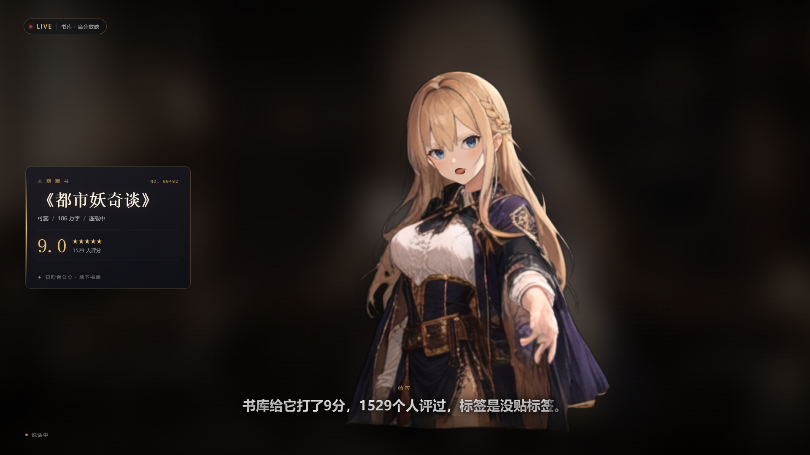

# 虚拟主播

没有什么新东西，都是ai整合互联网已有的内容。
你可以使用一张人物图、一份数据库、一个游戏，其中一样就能开播。可以闲聊，可以挂在游戏旁边陪播，也可以改成讲书。
不会编程的话，按 [教程.md](教程.md) 做，傻瓜一键式处理。



默认是闲聊。工作室里可以改成「玩游戏」或「讲书」。讲书才会用到书目。弹幕可以接哔哩哔哩、YouTube、Twitch、Kick 或斗鱼，一次一个平台；推流就是把网页推进 OBS 或对应平台的直播工具。钥匙、房间号、登录 Cookie 只写在你自己电脑的 `.env` 里，这个文件不会上传。

---

## 它由四块组成

| 模块 | 做什么 | 技术 |
|---|---|---|
| 形象 | 单张立绘 → 分层 PSD → 部件层 | [see-through](https://github.com/shitagaki-lab/see-through)（SIGGRAPH 2026） |
| 驱动 | 呼吸、眨眼、口型、头部转动、发丝摆动、镜头视差 | Three.js 透视相机 + 分层置换 |
| 大脑 | 按直播类型接弹幕：闲聊、看游戏、或讲书 | DeepSeek `deepseek-chat` |
| 直播 | 读 B 站弹幕、出声、上屏 | B 站 WebSocket + edge-tts + OBS 浏览器源 |

> **关于「3D」**：see-through 产出的是**带绘制顺序的 2.5D 分层**。本项目把每层按深度放进同一个透视场景，用真实摄像机做视差、按颈部/脚底枢轴做头身转动，视觉上是立体的；它不是可自由旋转的网格模型（那需要 VRM/3D 建模，see-through 不做这件事）。

---

## 已经跑通的部分

- **形象**：`index002.jpg` → see-through 远程分解（24 层，保留 14 层）→ `assets/avatar/manifest.json`
- **目录**：本地数据库 `yousuu.sqlite`（31.4 万本书、174 万条评论）→ **19,788 本高分书**（≥20 人评价，剔除名著/出版物与女频，其中历史文 1,499 本），每本带最多 3 条净化后的读者短评
- **链路**：弹幕 → 检索 → DeepSeek → 分句 → edge-tts → 舞台（字幕 + 口型 + 书卡）
- **B 站**：弹幕协议已接通。不填写房间号时不会去连直播间；聊天推送需要你自己在页面里填写登录 Cookie，Cookie 只保存在本机 `.env`。
- **DeepSeek**：用本地 mock（`scripts/mock_llm.py`）跑通流式回复 → 分句 → 逐词时间轴 → TTS 全链路，填上真实 Key 即用
- **自检**：`python scripts/test_pipeline.py`、`python scripts/test_book.py` 均通过（含真实语音合成）

---

## 开盒即用

双击 **`打开.bat`**（和 `start.bat` 是同一个入口）。

没有安装 Python 也没关系：它会把 Python 3.11 和依赖下载到 `runtime\`，只在第一次需要联网。装过之后，再双击就是直接开工作室。

浏览器打开的是工作室，不是一堆命令：

1. **上传一张立绘**。png / jpg 会自动分层并生成可直播的形象；已经分好层的 PSD 会直接用。
2. **钥匙和房间号**写在页面里，会进本机 `.env`，不会进 `config/app.yaml`。玩游戏和闲聊不用书库。选「讲书」才会用 `data/catalog.json`。
3. **开始直播**。弹出舞台窗口，并生成 **`直播间\`** 文件夹。
4. **下次**不用再上传，双击 `直播间\开始直播.bat`。

不填钥匙也能播，只是回答比较固定。三种直播：闲聊、玩游戏、讲书。

---

## 快速开始

### 0. 环境

- Windows 10/11。不需要事先安装 Python；想用自己的 Python 也可以，需要 **3.11+**
- 能访问 `api.deepseek.com`（语音合成还需要能访问微软的语音服务）。第一次准备 `runtime\` 时还要能下载 Python
- OBS Studio 30+，或者直播姬的窗口捕获

### 1. 填 DeepSeek Key

两种方式，任选：

- **控制台填**：启动后打开 <http://127.0.0.1:8765/panel>，在「DeepSeek API Key」里粘贴，保存。
- **环境变量**：复制 `.env.example` 为 `.env`，填 `DEEPSEEK_API_KEY=sk-...`。

Key 在 <https://platform.deepseek.com/api_keys> 申请。**不填也能跑**，此时用固定话术接弹幕。详细的点击步骤在 [教程.md](教程.md)。

### 2. 启动

双击 `打开.bat` 或 `start.bat`（也可以右键 `start.ps1` → 用 PowerShell 运行）。

它会准备运行环境、打开工作室、启动服务：

- 工作室 <http://127.0.0.1:8765/>
- 控制台 <http://127.0.0.1:8765/panel>
- 直播画面 <http://127.0.0.1:8765/stage>

停止服务：双击 `stop.bat`（或关闭那个命令行窗口）。

### 3. OBS 加画面

1. 生成场景文件：`python scripts/make_obs_scene.py`
2. OBS → 菜单「场景集合」→「导入」→ 选 `obs/薇拉书库.json`
3. 里面已有一个 1920×1080 的**浏览器源**，地址 `http://127.0.0.1:8765/stage`，并勾选了「通过 OBS 控制音频」

> 导入失败也没关系，手动加：来源 ➕ → 浏览器 → 宽 1920 高 1080 → URL 填上面的地址 → 勾选「通过 OBS 控制音频」。

### 4. B 站开播（三种方式，选一种）

先明确一件事：**B 站「自带直播系统」（直播姬 / 网页开播）不需要推流地址**，它自己就是推流端；只有用 OBS 这类第三方软件才需要填推流地址。

| 方式 | 要推流地址吗 | 画面从哪来 | 适合 |
|---|---|---|---|
| 直播姬 | 不要 | 窗口捕获 / 屏幕捕获 | 已经装了直播姬，想最快开播 |
| OBS | 要 | 浏览器源（最干净、音频独立） | 想要稳定画质和场景切换 |
| 网页开播 | 不要 | 屏幕共享 | 临时播一下 |

**A. 直播姬（已实测）**

1. 先双击 **`open_stage.bat`**：弹出一个 1920×1080、无地址栏的舞台窗口
2. 直播姬 → 添加素材 → **窗口** → 选中这个窗口
3. 玩游戏时再加一个窗口或游戏画面，把人物窗口摆在角落
4. 音频：确认系统声音没有静音。人物的声音从浏览器出来
5. 点开播

> ⚠️ 直播姬 8.9 的「浏览器」素材不能直接用来放舞台：它固定按 **800×600** 渲染网页，16:9 的画布会把它拉伸变形（实测页面 `innerWidth=800`）。如果你之前加过浏览器素材，删掉它，改用上面的「窗口」捕获。
>
> 另外：直播姬场景文件（`%LOCALAPPDATA%\bililive\User Data\<uid>\untitledv2.json`）是 OBS 格式，`scripts/livehime_inject.py` 可以往里写浏览器源，但同样受 800×600 限制，仅作备用。

**B. OBS（需要推流地址，地址在这里找）**

推流地址位置：

- 电脑浏览器打开 <https://link.bilibili.com/p/center/index>
- 左侧「我的直播间」→「开播设置」
- 页面下方「直播推流地址」，形如
  `rtmp://live-push.bilivideo.com/live-broadcast?streamname=…&key=…`
- 有些账号显示成两栏：「推流地址」+「串流密钥」，OBS 里分开填
- **需要先完成实名认证**；没实名时页面只提供直播姬/网页开播，不显示推流地址
- 直播姬里也能看：设置 → 推流 → 复制地址

OBS 里：设置 → 直播 → 服务「自定义」→ 服务器填 `rtmp://…`，串流密钥填 `…`（或把整条地址粘进服务器）。
输出建议：1920×1080、30fps、6000 Kbps、N 卡用 NVENC。

**C. 网页开播**：B 站首页点「开播」→ 屏幕分享 → 选 `open_stage.bat` 的窗口，勾选分享音频。

> 弹幕连接只认你自己填写的房间号。匿名连接往往收不到聊天弹幕。正式直播请在控制台填写 B 站 Cookie，它只保存在本机 `.env`，不要发给别人，也不要提交到仓库。

---

## 她会怎么直播

导演按优先级处理：

1. **Super Chat** —— 最高优先级，插队回应
2. **舰长 / 礼物** —— 简短答谢
3. **普通弹幕** —— 按当前直播类型回答。闲聊和玩游戏不查书；讲书才会检索书目
4. **空闲** —— 超过 `idle_book_after` 秒没人说话。闲聊和玩游戏会自己找一句轻的话；讲书才会挑一本没讲过的书

讲书的两个偏好：

- **优先历史文**：`director.history_ratio` 默认 0.75，四分之三的场次从历史类里挑
- **以读者短评为骨架**：口播稿会先转述读者为什么喜欢它（可引用一句），再说适合谁；没有短评的书退回标签+字数+状态

节奏控制：

- 同一观众 25 秒内只回一条，全局 1.5 秒一条，队列上限 6 条
- 每条回复自动切句合成，字幕逐字高亮，嘴型跟随音量
- 讲完一本会记进数据库，不会重复讲（可在控制台手动「讲下一本」）

**省 token 策略（默认开启）**

- **没人时**：讲书稿走本地固定模板（3 套轮换），**不调用 DeepSeek**
- **有人时**：在线观众 / 有人进场 / 发弹幕 / 送礼，任意一个出现就切回 DeepSeek
- 弹幕回复始终走 DeepSeek（因为有人在问）
- 判定窗口：`director.audience_window`，默认 600 秒；最后一次互动后 10 分钟内都算「有人在」
- 控制台的「观众」和「API 调用」两行可以实时确认：无人时应为「无人 · 固定话术省 token」「0 次」

> 实测：空闲 12 秒内自动讲书 1 本，API 调用 0 次；随后模拟一条弹幕，API 调用变成 1 次。

**画面构图**

- 书卡宽度随画布自适应（`clamp(190px, 20.5vw, 392px)`），角色会按书卡实际占位自动缩放并右移，**16:9 / 4:3 都不会遮挡**
- 舞台是响应式的，换分辨率或窗口大小不需要改任何东西

人设写在 `config/persona.md`（薇拉：冒险者公会地下书库管理员，温和毒舌、不剧透）。改这个文件就能换性格，重启生效。

---

## StandRig 高可动（可选）

分层 PSD 如果要做成带物理演算的高可动模型，按绘爱さやか公开的做法，把 PSD 和一句提示词交给 [StandRig](https://github.com/sayaka-aiart/StandRig)。提示词、出处和 Connect（摄像头、口型、Spout2）写在 [docs/standrig.md](docs/standrig.md)，原文在 `assets/standrig/PROMPT.txt`。

工作室生成形象时，会把当前 PSD 和这段提示词放进 `assets/standrig/工作区/`。网页舞台不依赖这一步，分层完成就能开播。

---

## 换一张立绘

工作室页面直接上传即可。想自己跑命令：

```powershell
# 1) 分解（远程 HF Space，免费额度约每天 1~2 次）
python scripts/seethrough.py --image 你的立绘.png --resolution 1024

# 2) 转成网页分层资源
python scripts/build_avatar.py --psd assets/source/你的立绘.psd --name 薇拉

# 3) 刷新舞台页面
```

建议：

- **全身、正面、纯色或透明背景**，高度 ≥1200px，效果最好
- 半身像也能用（当前这张就是半身），但下半身会被裁掉
- 分辨率越高，直播时越清晰；`--resolution 1280` 更清晰但更慢、更容易排队
- 没有 PSD 时可先兜底：`python scripts/build_avatar.py --fallback-image index002.jpg`（整图单层，只用于跑通链路）

> 本机是 GTX 750 Ti 4GB，跑不动本地 SDXL 推理，所以默认走官方 Space。有 12GB+ 显存时可按 [see-through README](https://github.com/shitagaki-lab/see-through) 本地跑 `inference_psd.py`，把 PSD 丢进 `assets/source/` 即可，后续步骤完全一样。

---

## 书库目录

目录从你拷进来的 `yousuu.sqlite` 生成，不依赖网站是否可访问：

```powershell
# 默认：≥20 人评价、按加权分取前 20000 本，剔除名著，每本带最多 3 条读者短评
python scripts/build_catalog_from_db.py

# 想收紧
python scripts/build_catalog_from_db.py --limit 8000 --min-score 6.5 --min-raters 50

# 临时不排除名著（默认会读 config/classics.txt）
python scripts/build_catalog_from_db.py --no-exclude
```

规则：

- **评分人数 ≥ 20**（你要求的下限），按**贝叶斯加权分**排序取前 2 万本
- **剔除名著/出版物**：`config/classics.txt` 里是关键词名单（书名或作者命中即排除），另外自动排除 `作者以 _出版 结尾`、书名含「全集/文集/辞典/教材」这类
- **剔除女频**：`config/female_tags.txt` 里是标签关键词（言情、纯爱、百合、女尊、女强、甜文、宫斗、宅斗、白月光、替身、ABO 等 46 条），命中任一标签即排除；想保留用 `--keep-female`
- 每本标注 `category = history / other`，直播时 **75% 从历史文里挑**（`director.history_ratio`）
- 每本抓最多 **3 条真实读者短评**，作为口播话术的主要素材
- 短评会先**净化**：`python scripts/clean_quotes.py` 用 DeepSeek 把网络短评改写成 18~36 字的文明短句，删脏话、人身攻击、性暗示、剧透，改不动的直接丢弃；结果缓存在 `data/quote_clean.json`，可断点续跑
- 当前状态：**13,141 条短评全部净化，0 条命中脏话词表**（词表在 `config/profanity.txt`，服务加载时还会再过滤一遍兜底）
- 再做一道后处理 `python scripts/polish_quotes.py`：丢掉讨论影视改编/剧版的句子、擦边词和超长短评，并把更像好评的排到前面

排序用**贝叶斯加权分**：`(score × raters + 6.8 × 250) / (raters + 250)`，避免「3 个人打 10 分」压过「5000 人打 8.6 分」。

网页抓取版 `scripts/fetch_bookbox.py` 也保留着。它默认不访问任何网站，只有你自己设置了 `BOOKBOX_BASE` 才会去抓。

生成后点控制台的「刷新目录」，或在 `data/catalog.json` 更新后重启服务。

---

## 控制台能做什么

- 看链路状态（DeepSeek / 语音 / B 站 / 目录 / 形象）
- 改直播间号、SESSDATA、API Key、音色、空闲讲书间隔
- 让薇拉说一句（直接测试 TTS 和口型）
- 模拟观众弹幕（不接 B 站也能调 Prompt）
- 讲下一本、重连 B 站、刷新目录
- 实时日志

---

## 配置说明（`config/app.yaml`）

| 配置 | 说明 |
|---|---|
| `deepseek.model` | 默认 `deepseek-chat`；想更便宜可用 `deepseek-chat` 即可 |
| `tts.voice` | 默认 `zh-CN-XiaoyiNeural`（少女音）；`zh-CN-XiaoxiaoNeural` 更甜，`zh-CN-YunxiNeural` 是男声 |
| `tts.rate` / `pitch` | 语速 / 音高，`+10%`、`+12Hz` |
| `director.idle_book_after` | 空闲多少秒后主动讲书 |
| `director.audience_window` | 最后一次观众互动后多少秒内仍算「有人」，默认 600；无人时不调 API |
| `director.per_user_cooldown` | 同一观众冷却 |
| `director.intro_min_score` / `intro_min_raters` | 选书门槛，默认 6.5 分 / 20 人评 |
| `director.history_ratio` | 历史文占比，默认 0.75 |
| `avatar.camera_fov` / `parallax` | 镜头视角 / 视差强度 |
| `bilibili.ignore_users` | 不回复的用户名列表 |

改完保存，点控制台对应按钮或重启服务。

---

## 常见问题

**画面全黑 / 没有形象**
先看 `assets/avatar/manifest.json` 是否存在；控制台「直播形象」应显示「已加载分层形象」。没有就重跑 `build_avatar.py`。

**有字幕没声音（OBS 里）**
浏览器源要勾「通过 OBS 控制音频」，音频混音器里会出现「薇拉舞台」。普通浏览器里需要点一下画面解锁自动播放。

**弹幕连不上 / 连上但没弹幕**
- 「连接失败」：看控制台的错误码。`-352` 是 B 站风控，本项目已自动改用 `getConf` 接口取 token，正常不会再出现。
- 「已连接」但一直没弹幕：这是**未登录**的典型表现。把浏览器登录后的整段 Cookie 粘到控制台（要含 `SESSDATA` 与 `DedeUserID`），保存后点「重连 B 站」。
- 房间号短号/真实号都行；房间没开播时也不会有弹幕。

**TTS 报错**
edge-tts 依赖微软在线服务，需要能访问 `speech.platform.bing.com`。公司网络/代理可能拦截；可换 `tts.engine: sapi`（音质差）或自行接 GPT-SoVITS。

**端口被占用**
改 `config/app.yaml` 的 `server.port`，OBS 地址和 `make_obs_scene.py --url` 一起改。

**想让它只在本地测试**
控制台不填房间号即可；用「模拟观众弹幕」调试。

---

## 目录结构

```
live2D形象制作/
├─ 打开.bat / start.bat       双击开播（没有 Python 也会自备 runtime\）
├─ 教程.md                    给不会编程的人看的步骤
├─ run.py                     启动入口
├─ 直播间/                    点「开始直播」后生成，下次双击这里
├─ runtime/                   便携 Python，首次启动下载，不进仓库
├─ config/
│  ├─ app.yaml                所有可调参数
│  └─ persona.md              薇拉的人设
├─ server/
│  ├─ main.py                 FastAPI + WebSocket + 静态资源
│  ├─ studio.py               上传形象、弹出舞台、生成直播间文件夹
│  ├─ director.py             直播导演（队列/优先级/讲书节奏）
│  ├─ brain.py                DeepSeek 提示词与调用
│  ├─ catalog.py              目录加载 + BM25 检索
│  ├─ danmaku.py              B 站弹幕 WebSocket
│  ├─ tts.py                  edge-tts 合成与缓存
│  └─ store.py                SQLite（讲过的书/记忆/日志）
├─ web/
│  ├─ studio.html/css/js      工作室：上传立绘、开始直播
│  ├─ stage.html/css/js       直播画面（WebGL 分层渲染）
│  ├─ panel.html/css/js       控制台
│  └─ vendor/three.module.js  Three.js（本地，离线可用）
├─ scripts/
│  ├─ seethrough.py           调 see-through 分解立绘
│  ├─ build_avatar.py         PSD → 分层 PNG + manifest
│  ├─ build_catalog_from_db.py数据库 → 高分目录
│  ├─ fetch_bookbox.py        网页抓取版目录（备用）
│  ├─ make_obs_scene.py       生成 OBS 场景
│  └─ test_pipeline.py        端到端自检
├─ assets/
│  ├─ source/                 see-through 原始产物
│  ├─ avatar/                 manifest.json + layers/ + backdrop.jpg
│  └─ standrig/               StandRig 提示词与交接说明
├─ data/
│  ├─ catalog.json            高分目录
│  └─ audio/                  TTS 缓存
└─ yousuu.sqlite              原始书库（本地使用，体积大，不进 Git 仓库）
```

---

## 说明与边界

- see-through 是**开源研究项目**（ACM SIGGRAPH 2026），官方明确没有付费服务；商用/大规模使用请自行确认许可与算力。
- B 站弹幕走的是公开 WebSocket 接口，不是官方开放平台；高频请求可能被风控。要稳定商用请申请 B 站直播开放平台。
- 生成的口播稿基于书目元数据和读者短评，**不保证剧情细节准确**；人设里已要求「不确定就说不知道、不剧透」。
- 直播内容请遵守 B 站社区规范；AI 主播建议在直播间简介中注明。
